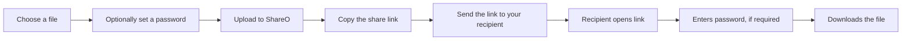
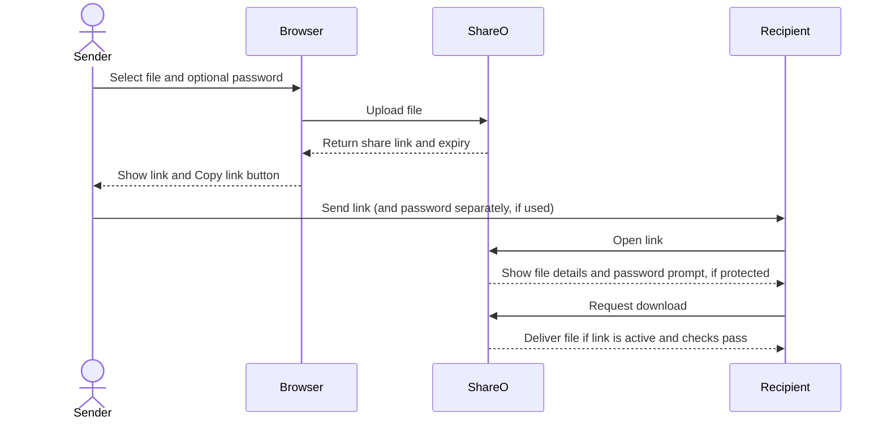
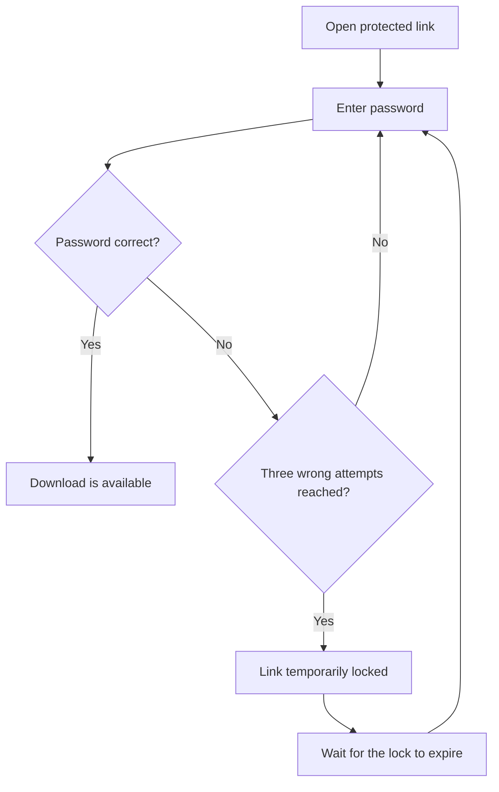
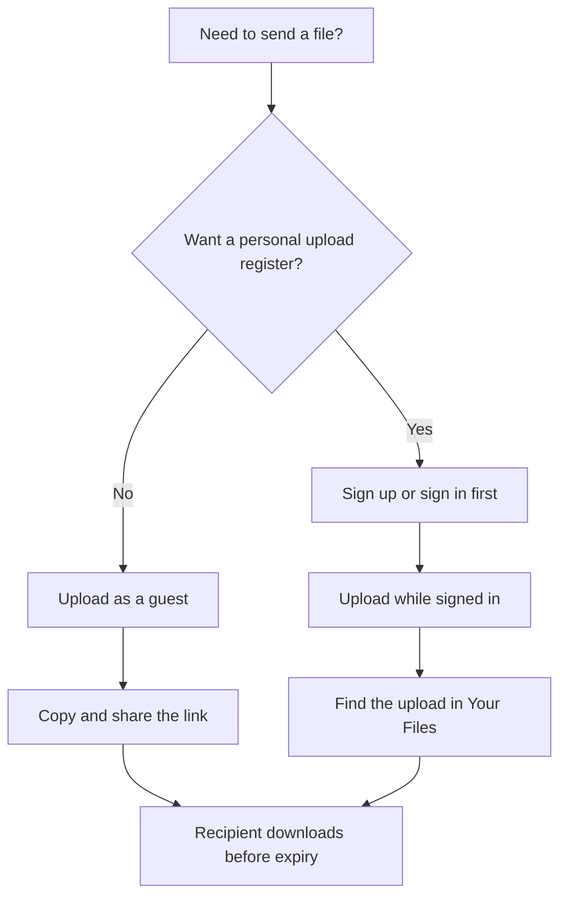
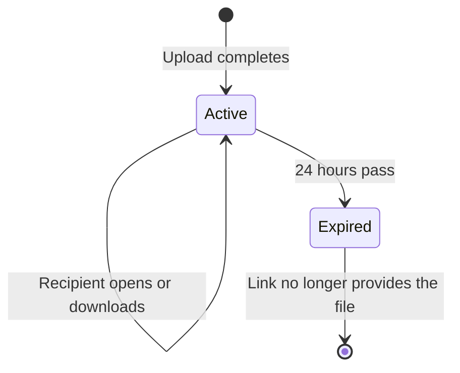

# ShareO

**Share a file with a link—without making the recipient create an account.**

ShareO is a simple file-transfer website. Choose a file, optionally protect it with a password, upload it, and send the generated link to the person who needs it.

**Open ShareO:** <https://share-otrans.vercel.app/>

This guide explains how to send and receive files, what happens to a transfer, and what to do if something goes wrong.

## Contents

- [At a glance](#at-a-glance)
- [Send a file](#send-a-file)
- [What happens after upload](#what-happens-after-upload)
- [Receive and download a file](#receive-and-download-a-file)
- [Use an account and your file register](#use-an-account-and-your-file-register)
- [Limits, passwords, and expiry](#limits-passwords-and-expiry)
- [Troubleshooting](#troubleshooting)
- [Frequently asked questions](#frequently-asked-questions)
- [Getting help](#getting-help)

## At a glance

| What | How ShareO works |
| --- | --- |
| Account needed to send or receive? | No. An account is optional and is useful for keeping a register of your uploads. |
| Maximum upload size | 100 MB per file |
| Password protection | Optional; set it when uploading |
| Link lifetime | 24 hours from upload |
| Recipient account | Not required |

### The basic handoff



## Send a file

1. Open [ShareO](https://share-otrans.vercel.app/).
2. Select **Browse from your device** or drag a file into the upload area.
3. Check that the selected file is the one you want to send. To change it, select **Replace** and choose another file.
4. If you want password protection, enter a password in the optional password field. Leave it blank for a link that does not ask for a password.
5. Select **Upload & create link** and wait for the upload to finish. The progress indicator shows the upload status.
6. When **Link ready to share** appears, select **Copy link**.
7. Send the copied link to the recipient. If you set a password, share that password separately.

The result shows the file name, size, and the time the link expires. The recipient does not need to sign in or create a ShareO account.

### Keep the link and password in mind

Treat the share link as something only the intended recipient should have. Without a password, anyone who has the link can try to download the file before it expires. A password adds an extra step for the download; it does not change the link's expiry time.

If you set a password, send it through a different communication channel from the link when practical. Avoid using a password that you also use for another account.

## What happens after upload

ShareO gives the upload a unique link and records information needed to display and deliver it, such as the file name, size, password-protection status, and expiry time.



ShareO does not make the file permanent. The link is intended for a short-lived handoff, not long-term storage or backup.

## Receive and download a file

1. Open the full share link in a browser.
2. Check the displayed file name and expiry information.
3. If the sender protected the file, enter the password they gave you.
4. Select **Download** and wait for the browser to save the file.

If the link is not password-protected, the download button is available without entering a password. You do not need to register to receive a file.

### Password attempts

For a protected file, ShareO allows up to three incorrect password attempts before temporarily locking access to that link. The default lock lasts 30 minutes. If this happens, check the password with the sender and try again after the lock expires.



## Use an account and your file register

You can send a file without an account. If you want a place to review uploads associated with you, create an account or sign in before uploading.

1. Choose **Sign Up** or **Sign In** in the site navigation.
2. To create an account, enter a valid email address, create a password of at least eight characters that meets the sign-up form's strength check, and confirm it.
3. After signing in, upload your file as usual.
4. Open **Your Files** to see files uploaded while you were signed in.

The register shows each file's expiry and whether it has password protection. For active files, you can open the download page or copy the link. If you set a file password, the register lets you reveal or hide it.

Files uploaded as a guest are not associated with your account and will not appear in your register. Signing in does not extend a link's 24-hour lifetime. An expired file cannot be reopened from the register.

### Which path should I use?



## Limits, passwords, and expiry

### File size

Each upload can be up to **100 MB**. If your file is larger, reduce its size or split it into smaller files before uploading. ShareO rejects files over the limit.

### File types

Executable and script files are not accepted. This includes formats such as `.exe`, `.dll`, `.bat`, `.sh`, `.msi`, `.ps1`, `.jar`, and similar executable or scripting extensions. If an upload is rejected, check the file type and try a permitted document, image, audio, video, or archive file instead.

### Optional password

Password protection is set separately for each upload. The recipient needs the password to download a protected file. A password-protected link still expires after 24 hours.

Because the recipient can see the file name and expiry on the download page, avoid putting private details in the file name itself. Only share the link and password with the people you intend to receive the file.

### 24-hour expiry

The link lasts for **24 hours from the time of upload**. After that, ShareO will not provide the file from that link. Expired links cannot be renewed; upload the file again to create a new link.



Do not use ShareO as the only copy of an important file. Keep your own copy until the recipient confirms they have downloaded it.

## Troubleshooting

### The link starts with `localhost:3000`

`localhost` points to the computer running the development version of the website; it is not the public ShareO address. For the live site, a new link should start with:

```text
https://share-otrans.vercel.app/
```

If a new upload still generates a localhost link, contact the site administrator. The deployed site's public base URL needs to be configured and the site redeployed. Links already created with `localhost` should be re-created after the configuration is fixed.

### The upload does not start or fails

- Confirm that you selected a file.
- Check that the file is no larger than 100 MB.
- Make sure it is not an executable or script file.
- Check your internet connection and try again.
- If the problem continues, try again later or contact the site administrator.

### The link says the file is missing or expired

The link may have passed its 24-hour lifetime, or the file may no longer be available. Ask the sender to upload the file again and send you the new link.

### The password is not accepted

Check that you have the exact password from the sender, including capitalization and punctuation. After three incorrect attempts the link is temporarily locked; wait for the lock to expire before trying again.

### The download does not begin

Confirm that the link has not expired, complete the password step if one appears, and check whether your browser blocked or redirected the download. You can also try opening the link in another browser. If the problem remains, ask the sender to create a new handoff.

### I cannot find an upload in Your Files

The register only lists files uploaded while you were signed in to that account. A guest upload, or an upload made under a different account, will not appear there. The register does not extend the file's lifetime.

## Frequently asked questions

### Does the recipient need a ShareO account?

No. The recipient can open the link and download the file without signing up. They will need the password if the sender enabled password protection.

### Do I need an account to upload?

No. Guest uploads are supported. An account is optional and lets you view the register of files you upload while signed in.

### Can I remove or extend a link myself?

The current user interface does not provide a button to manually extend or delete an upload. Links expire after 24 hours. If a recipient needs more time, upload the file again to create a new link.

### Can an expired link be used again?

No. Once a file has expired, its link will not provide the download. The sender needs to upload the file again.

### Is this a backup service?

No. ShareO is for temporary file handoffs. Keep an independent copy of anything you need to retain.

## Getting help

For a question, bug report, or feedback, use the **Connect** page linked from the site navigation. Include the steps you took and any error message you saw. Do not send your account password or a private file's password in a support request.

---

**ShareO** · Temporary file handoffs, made simple.
